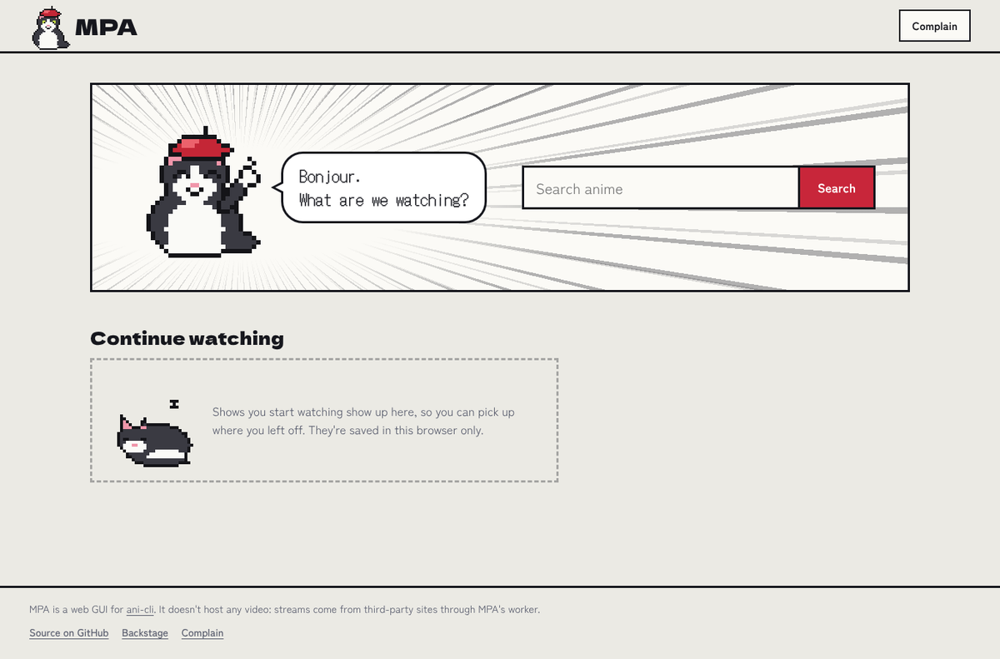
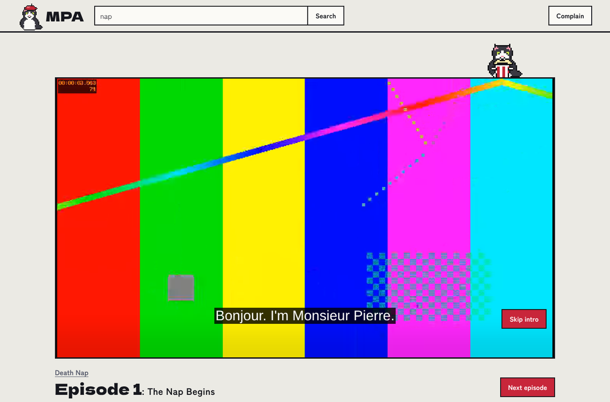
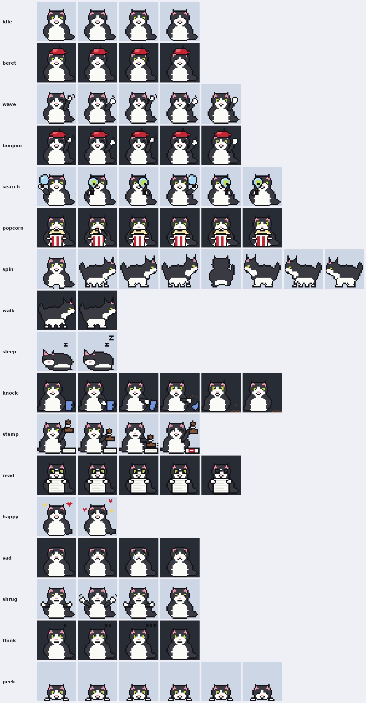

<p align="center"></p>

# MPA: Monsieur Pierre's ani-cli

A web GUI for [ani-cli](https://github.com/pystardust/ani-cli) that runs on GitHub Pages. You open the site, search for an anime, pick an episode and watch it. No accounts, no install. Monsieur Pierre, the lazy tuxedo cat from [oneko-woah](https://github.com/lolesterrr/oneko-woah), keeps you company and runs the complaint desk.

<p align="center">
  
  
</p>

## How it works

GitHub Pages only serves files, and ani-cli is a shell script, so MPA splits the job in two:

```
your browser  ──>  MPA site (GitHub Pages, the web/ folder)
      │
      └──────────> MPA worker (Cloudflare, the worker/ folder)  ──>  hianime and its stream host
```

The worker does in JavaScript what ani-cli does with curl and sed: search page, episode list, episode servers, the ZokoAnime embed and its obfuscated player config, then the m3u8 stream. It also relays the video, because the stream host only answers requests that carry the embed page as Referer, which a web page can't set, and it doesn't send the CORS headers a browser needs. Relay links are signed and expire, so the worker can't be used as an open proxy.

The scraping follows ani-cli 5.1.5. A test runs the real ani-cli next to the worker and checks that both find the same links.

## Setup (about five minutes)

### 1. Deploy the worker

You need a free [Cloudflare](https://dash.cloudflare.com/sign-up) account.

**From the dashboard, no tools needed**

1. In the Cloudflare dashboard, go to Workers & Pages and create a new Worker from the "Hello World" starter. Name it `mpa` and deploy it.
2. Open the worker, choose **Edit code**, replace everything with the contents of [`worker/dist/mpa-worker.js`](worker/dist/mpa-worker.js) and deploy again.
3. In the worker's **Settings > Variables and Secrets**, add:
   - `SIGNING_KEY`, type **Secret**: any long random string (a password generator is fine, or `openssl rand -hex 32`). Required: it signs the video relay links.
   - `ALLOWED_ORIGINS`, type **Text**: `https://lolesterrr.github.io`. Optional: without it, any website can use your worker.
4. Copy the worker's address. It looks like `https://mpa.your-name.workers.dev`.

**Or with Wrangler**

```sh
cd worker
npx wrangler@4 login
npx wrangler@4 deploy
npx wrangler@4 secret put SIGNING_KEY
```

`wrangler.toml` already sets `ALLOWED_ORIGINS` and `GITHUB_REPO`.

### 2. Point the site at the worker

Put the worker's address in [`web/config.js`](web/config.js):

```js
window.MPA_CONFIG = {
  api: "https://mpa.your-name.workers.dev",
  repo: "lolesterrr/MPA-monsieur-pierre-aniCLI-",
};
```

Until you do, the site shows a setup screen where you can paste the address for your own browser.

### 3. Turn on GitHub Pages

In the repo: **Settings > Pages > Build and deployment > Source: GitHub Actions**. The [Pages workflow](.github/workflows/pages.yml) publishes `web/` on every push that touches it. The site lives at <https://lolesterrr.github.io/MPA-monsieur-pierre-aniCLI-/>.

### 4. Check it

Scroll to the bottom of the site, open **Backstage** and press **Check the connection**. You want four green squares: worker, video relay, complaint desk and hianime.

### Optional: let the complaint desk file issues itself

Every page has a **Complain** button. Without extra setup, a complaint opens a GitHub "new issue" page with everything filled in, so the person needs a GitHub account to send it. To have the worker file complaints directly, as issues labelled `complaint`:

1. On GitHub: Settings > Developer settings > Personal access tokens > **Fine-grained tokens** > Generate new token.
2. Repository access: only this repo. Permissions: **Issues: Read and write**. Nothing else.
3. Add it to the worker as a secret named `GITHUB_TOKEN`.

Complaints are public issues, and the desk says so. It attaches the page, the anime and episode, the last error and the browser, and shows exactly what it attaches before sending. Each visitor can file about 5 complaints per 10 minutes (`COMPLAINTS_PER_10_MIN` changes that).

### Optional: deploy the worker from GitHub

The [Worker workflow](.github/workflows/worker.yml) redeploys the worker whenever `worker/` changes, once you add two repo secrets: `CLOUDFLARE_API_TOKEN` (made from the "Edit Cloudflare Workers" template) and `CLOUDFLARE_ACCOUNT_ID`. Secrets like `SIGNING_KEY` stay in Cloudflare.

## If Cloudflare blocks the worker

hianime sits behind Cloudflare's bot check. ani-cli itself sometimes needs [curl-impersonate](https://github.com/lwthiker/curl-impersonate) to get through, and a Cloudflare worker can't pretend to be a browser the same way. If search shows "Cloudflare stopped the worker at hianime's door" and it doesn't go away after a while, run the local helper instead. It is the same worker code running on your computer, and it uses curl-impersonate for page requests when it's installed, the way ani-cli does:

```sh
node local/server.mjs                 # then open http://localhost:8787
HOST=0.0.0.0 node local/server.mjs    # also reachable from your phone on the same Wi-Fi
```

It needs Node.js 20 or newer. Opened at `http://localhost:8787`, the site connects to the helper by itself. To use the GitHub Pages site with it, set the worker address in Backstage to `http://localhost:8787` (Chrome and Firefox allow that; Safari may not).

## What's in it

- Search with posters, type, episode count and dub availability
- Episode grid with watched, filler and last-watched markers, in pages of 100 for long shows
- Player with quality switching, subtitles, skip intro and recap (from [AniSkip](https://aniskip.com)), resume where you stopped, and the next episode after a countdown
- Sub and dub, remembered per browser
- Continue watching on the home page, kept in this browser only
- "Other players": copy the stream link for mpv or VLC, or open it in IINA on a Mac
- Complaint desk on every page, with report buttons on every error
- Light and dark themes, works on phones, keyboard friendly, respects reduced motion
- No accounts and no trackers. Fonts and the video player are bundled with the site

## Monsieur Pierre

Pierre's sprites come from `tools/makepierre.py`, copied unchanged from the oneko-woah repo, where he was born. MPA gives him more to do: [`tools/makepierre_mpa.py`](tools/makepierre_mpa.py) builds 14 new animations with the same 32×32 frames, palette and outline pass, with props drawn as separate outlined layers. Click Pierre on the home page, on a poster or on the player for a joke.

<p align="center"></p>

| Animation | Where he does it |
| --- | --- |
| `bonjour`, `beret` | Home page, logo, share image |
| `search` | Looking up a search |
| `think` | Fetching episodes, Backstage |
| `popcorn`, `peek`, `sleep` | Sitting on the player: watching, paused, paused for a long time |
| `knock` | Errors (yes, that's your mug) |
| `sad`, `shrug` | Nothing found, no dub, missing setup |
| `read`, `stamp`, `happy` | Complaint desk: reading, filing, done |
| `idle` | Sitting on the poster on an anime's page |
| `wave`, `walk`, `spin` | Spares, for whatever comes next |

Rebuild the sheet after changing him: `npm run sprites` (needs Pillow).

## Development

```sh
npm test          # worker unit and integration tests against a fake hianime (needs ffmpeg)
npm run demo      # the whole app offline on http://127.0.0.1:8787, with made-up shows
npm run e2e       # clicks through the demo in Chromium (needs Playwright; run the demo with FAKE_CODEC=vp9)
npm run build     # rebuild worker/dist/mpa-worker.js after editing worker/core.js
ANI_CLI=/path/to/ani-cli node --test test/parity.test.mjs   # compare with the real ani-cli
```

The site is plain HTML, CSS and JavaScript modules with no build step. The worker has no dependencies.

### Keeping up with ani-cli

hianime changes things now and then, and ani-cli ships fixes. When that happens, port the change from ani-cli's `hianime_*` functions into `worker/core.js`, run `npm run build`, and update the fake site in `test/fake-hianime.mjs` if the markup changed. The **ani-cli canary** job in the test workflow runs every Monday against the latest ani-cli and goes red when its scraping no longer matches.

## Limits

- Cloudflare's free plan allows 100,000 worker requests a day. Every video segment is a request, so an episode costs a few hundred. Plenty for you and your friends, not for a big public site.
- Like ani-cli, MPA only plays the ZokoAnime server. When an episode isn't on it, MPA says so.
- Stream links expire after 6 hours. If you pause for longer, MPA fetches fresh ones and carries on.

## Layout

```
web/       the site (GitHub Pages serves this folder)
worker/    core.js (the scraper and relay), worker.js (Cloudflare entry), dist/ (single-file copy)
local/     the local helper
tools/     Pierre's sprite generators, the worker bundler
test/      fake hianime, worker tests, ani-cli parity test, browser test, offline demo
```

## Credits and license

MPA is GPL-3.0, like ani-cli, whose scraping logic the worker follows. The sprite generator comes from oneko-swift (MIT), the player is [hls.js](https://github.com/video-dev/hls.js) (Apache-2.0), and the fonts are Dela Gothic One, DotGothic16 and Zen Kaku Gothic New (SIL Open Font License). See [disclaimer.md](disclaimer.md): MPA doesn't host any video.
